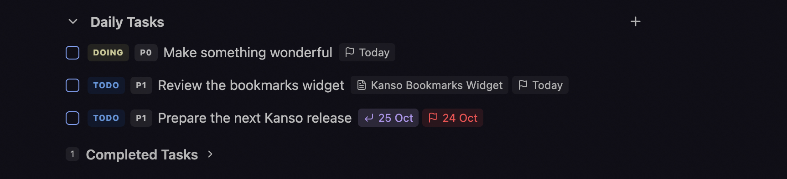
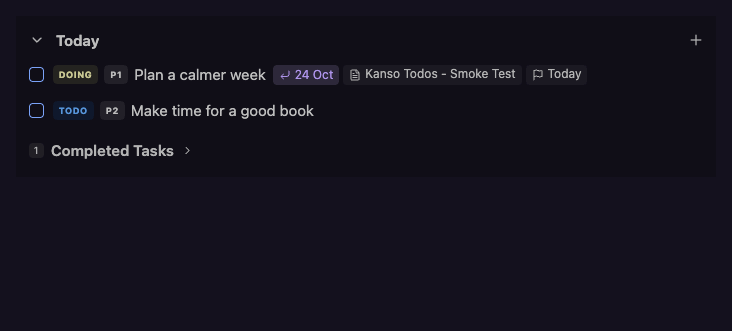

# Kanso Todos

**A compact, visual task list inside any note, backed by plain-text YAML.**

**Kanso (簡素)** means simplicity or plainness in Japanese. Keep tasks beside the notes they belong to. Add and edit them through a
theme-native widget, with status, priority, due dates, and links to source notes.



## Features

- Add and edit tasks inline without writing YAML.
- Track Todo, Doing, and Completed states, with P0-P2 priorities.
- Set due dates with local-calendar labels and overdue highlighting.
- Link tasks to source notes and open them directly.
- Collapse a list or expand its completed tasks independently in each pane.

If you've found Kanso Todos useful, please consider
[buying me a coffee](https://buymeacoffee.com/pshetty).

## Demo

Add a task with priority and a due date, complete it, and collapse the list:



## Installation

Open **Settings -> Community plugins -> Browse**, search for
**Kanso Todos**, then install and enable it.

For manual installation, download `main.js`, `manifest.json`, and `styles.css`
from a [release](https://github.com/shettypuneeth/kanso-todos-obsidian/releases).
Place them in `<vault>/.obsidian/plugins/kanso-todos/`, then enable Kanso Todos
under Community plugins.

Requires Obsidian 1.8.7 or later. Desktop and mobile are intended platforms;
see the [release checklist](docs/releasing.md) for validation status.

## Getting started

1. Open a Markdown note in Live Preview.
2. Run **Kanso Todos: Insert todos widget** from the command palette.
3. Select **Add task**, enter a title, and optionally set Priority, Due, or Source note.
4. Press Enter or select Add.

You can also put this empty block in a note or daily-note template:

````markdown
```kanso-todos

```
````

The empty widget does not write anything until you interact with it.

For a custom heading, use a named empty list; `todos` is optional:

````markdown
```kanso-todos
version: 2
title: My tasks
```
````

The first task you add creates the list in the YAML. An explicitly supplied
`todos` field must be a list (`todos: []`), not a blank or scalar value.

## Working with tasks

Use the checkbox to complete a task; reopening it resets its status to Todo.
Select the Todo/Doing badge to switch active status. Select a priority badge
to cycle P0, P1, and P2; use Edit to set or clear optional properties.

Open a task's actions menu to edit or delete it. **Deletion is immediate**, with
no plugin-specific undo. New tasks appear first; changing status or completing
a task does not reorder the underlying YAML.

Enter in the title saves the form. Mod+Enter (Ctrl+Enter on Windows/Linux)
saves from anywhere in the form; Escape cancels. If another pane changes a task
while you edit, your draft is retained. Review the conflict before saving again:
the second explicit save replaces the newer editable values.

List collapse and the Completed section are temporary pane-local state, not
settings synchronized between devices. There is no settings page.

## Storage and compatibility

Tasks are stored in a top-level, unindented `kanso-todos` code block in the note.
They are **not Markdown checkboxes** and are not indexed by the Tasks plugin,
Dataview task queries, or Obsidian's checkbox search as ordinary Markdown tasks.
Kanso Todos does not aggregate tasks across your vault or synchronize checkboxes.

### Rollover links

Kanso Todos can display and follow existing `rollover.previous` and
`rollover.next` references. Entries with a next link become read-only historical
rows; incoming-only entries remain editable. Advanced authoring details are in the
[data reference](docs/todos.md#agent-authored-rollover-contract).

## Development

```sh
npm ci
npm test
npm run build
npm run check-release
```

`npm run dev` watches source changes. Production builds exclude sourcemaps.
Copy the generated `main.js`, `manifest.json`, and `styles.css` into a test vault's
`.obsidian/plugins/kanso-todos/` folder. Do not edit the generated bundle.

## Feedback

Report bugs or suggest improvements through
[GitHub Issues](https://github.com/shettypuneeth/kanso-todos-obsidian/issues).
For layout issues, include your Obsidian version, platform, theme, and a minimal
sample block without personal task data.
